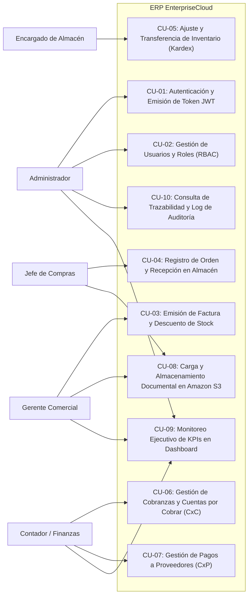

# ERP EnterpriseCloud - Especificación de Casos de Uso del Sistema

## 1. Identificación de Actores del Sistema
- **Administrador (IAM):** Control global de parámetros, gestión de usuarios, asignación de roles y supervisión de pistas de auditoría inmutables.
- **Gerente Comercial / Vendedor:** Gestión de cartera de clientes, emisión de cotizaciones, pedidos y facturación electrónica con descuento de existencias.
- **Jefe de Compras / Analista:** Registro de proveedores, emisión de órdenes de compra, control de cotizaciones y recepción de mercaderías.
- **Encargado de Almacén:** Monitoreo de stocks en tiempo real, registro de movimientos en Kardex, transferencias inter-almacenes y ajustes por conteo físico.
- **Analista de Finanzas / Contador:** Control de cobranzas a clientes (CxC), programación de pagos a proveedores (CxP), flujo de caja y balances.
- **Auditor del Sistema:** Inspección de trazabilidad y eventos de seguridad.

---

## 2. Diagrama de Casos de Uso de Alto Nivel

---

## 3. Especificación Detallada de Casos de Uso Críticos

### CU-01: Autenticación y Emisión de Token JWT
- **Actor Principal:** Todos los usuarios registrados.
- **Precondición:** El usuario debe estar activo en la base de datos `usuarios`.
- **Flujo Principal:**
  1. El usuario ingresa sus credenciales (usuario o correo y contraseña).
  2. El sistema valida el hash de contraseña utilizando SHA256/Bcrypt con salt criptográfica.
  3. Si la verificación es exitosa, se genera un token JWT firmado conteniendo ID de usuario, nombre de usuario y rol asignado.
  4. Se registra en la tabla `auditoria` el evento de login exitoso con fecha, hora e IP.
  5. El cliente recibe el token e inicializa la sesión en el frontend.
- **Flujo Alterno (401 Unauthorized):**
  - Si las credenciales no coinciden, se incrementa el contador de intentos fallidos y se registra en `auditoria` con estado `FALLIDO`.

### CU-03: Emisión de Factura y Descuento Automático de Stock
- **Actor Principal:** Gerente Comercial.
- **Precondición:** Existen existencias suficientes en el almacén de despacho para los ítems solicitados.
- **Flujo Principal:**
  1. El vendedor selecciona el cliente y el almacén origen.
  2. Agrega los productos indicando cantidades y precios acordados.
  3. El sistema calcula en tiempo real Subtotal, IGV (18%) y Total.
  4. Al confirmar la emisión:
     - Se genera la numeración correlativa única (ej. `VTA-2026-0001`).
     - Se descuenta el stock en el almacén mediante la función transaccional `modify_stock`.
     - Se asienta un movimiento de tipo `SALIDA` con referencia `VENTA` en el Kardex permanente.
     - Se actualiza el saldo deudor del cliente (`current_balance`) para control de CxC.
     - Se registra la acción en el log inmutable de auditoría.
- **Flujo Alterno:** Si el stock disponible es menor a la cantidad solicitada, el sistema aborta la transacción y arroja un error 400 con el detalle del producto deficitario.

### CU-05: Transferencia de Inventario entre Almacenes
- **Actor Principal:** Encargado de Almacén.
- **Precondición:** Stock suficiente en el almacén origen.
- **Flujo Principal:**
  1. Se selecciona producto, almacén de origen, almacén de destino y cantidad.
  2. El sistema verifica que almacén origen ≠ almacén destino.
  3. Ejecuta una transacción atómica:
     - Asiento 1: Movimiento `SALIDA` en almacén origen con reducción de stock.
     - Asiento 2: Movimiento `ENTRADA` en almacén destino con aumento de stock.
  4. Ambas operaciones quedan vinculadas con referencia `TRANSFERENCIA`.

### CU-08: Gestión Documental con Amazon S3
- **Actor Principal:** Vendedor, Comprador, Finanzas o Administrador.
- **Precondición:** Archivo físico en formato admitido (PDF, XML, XLSX, JPG, PNG).
- **Flujo Principal:**
  1. El usuario asocia el archivo a una entidad del ERP (Venta, Compra, Cliente o Producto).
  2. El backend procesa el archivo y calcula su nombre único (UUID + nombre original).
  3. Sube el blob a Amazon S3 con encabezado `Server-Side Encryption AES256`.
  4. Si no hay conexión o se está en modo contingencia local, almacena el archivo en el volumen `/uploads`.
  5. Se inserta en la base de datos relacional el registro de metadatos (tipo MIME, tamaño, ruta S3 y usuario emisor).
