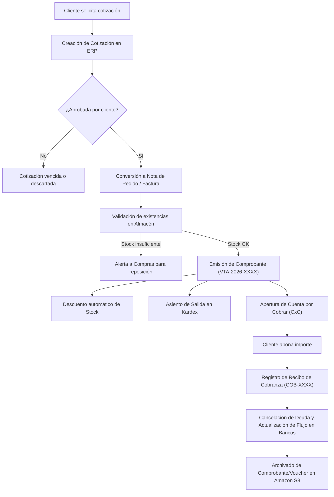
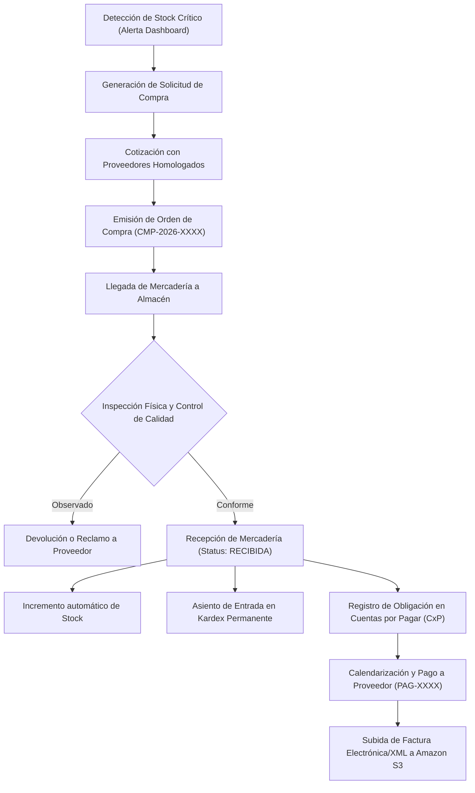
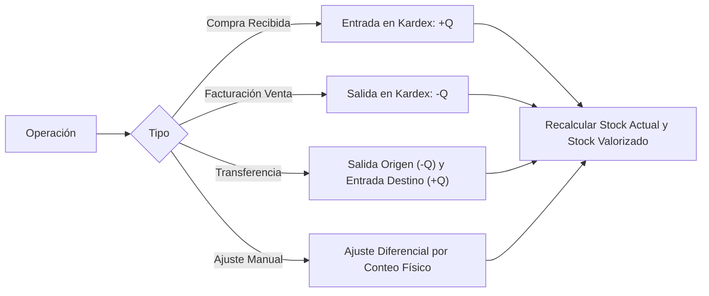

# ERP EnterpriseCloud - Mapa de Procesos Empresariales Integrados

## 1. Macroproceso Empresarial
El sistema **ERP EnterpriseCloud** integra los procesos de negocio bajo el paradigma de trazabilidad continua, donde cada evento operativo alimenta automáticamente el inventario físico, los libros contables/financieros y la pista de auditoría.

---

## 2. Diagrama de Proceso Comercial (Order-to-Cash)

---

## 3. Diagrama de Proceso de Compras (Procure-to-Pay)

---

## 4. Proceso de Kardex y Control Físico de Inventario
El control de existencias opera bajo el principio de inventario permanente.

---

## 5. Proceso de Gestión Documental y Respaldo Cloud
1. **Captura:** El usuario arrastra o selecciona el documento digitalizado (Factura, Guía de Remisión, Contrato).
2. **Normalización:** El API valida tamaño, tipo MIME y genera un nombre universal único con prefijo hash.
3. **Persistencia Híbrida Cloud:**
   - **Capa Blob:** El archivo binario viaja directamente al bucket de Amazon S3 asignado con cifrado en reposo.
   - **Capa Relacional:** Amazon RDS PostgreSQL guarda el ID de la transacción, bucket, URL segura, usuario creador y timestamp.
4. **Disponibilidad:** El archivo queda accesible de forma instantánea para auditorías tributarias o consultas de operaciones pasadas.
