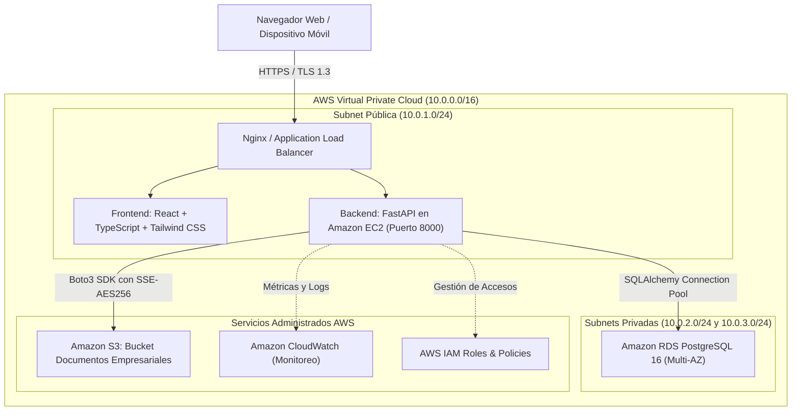

# ERP EnterpriseCloud - Documento de Arquitectura de Solución

## 1. Visión General de la Arquitectura
El sistema **ERP EnterpriseCloud** está concebido bajo una arquitectura en capas desacopladas, orientada a microservicios lógicos y preparada para ejecutarse en la nube pública de **Amazon Web Services (AWS)** conforme a los contenidos curriculares de la Semana 07.

---

## 2. Capas de la Arquitectura

### 2.1 Capa de Presentación (Frontend SPA)
- **Tecnología:** React 18, TypeScript, Tailwind CSS, Vite.
- **Iconografía:** Lucide React.
- **Características:**
  - Single Page Application (SPA) con enrutamiento reactivo por pestañas y módulos.
  - Diseño responsivo adaptado para estaciones de trabajo, tablets y terminales de almacén.
  - Interceptors HTTP para inyección automática del token Bearer JWT y control de expiración de sesión.
  - Almacenamiento seguro de estado en memoria y tokens en almacenamiento local protegido.

### 2.2 Capa de Aplicación y Servicios (Backend REST)
- **Tecnología:** Python 3.12+, FastAPI, Pydantic v2, Uvicorn (ASGI).
- **Características:**
  - Enrutamiento modular con prefijo versionado `/api/v1/`.
  - Inyección de dependencias (`Depends`) para sesiones de base de datos y autorización RBAC.
  - Validación exhaustiva de esquemas y tipos de datos en tiempo de ejecución.
  - Concurrencia asíncrona no bloqueante de alto rendimiento.

### 2.3 Capa de Persistencia Relacional
- **Tecnología:** PostgreSQL 16 (Amazon RDS) con compatibilidad transparente con SQLite para desarrollo y pruebas locales.
- **ORM:** SQLAlchemy 2.0 con mapeo declarativo, índices B-Tree estratégicos y restricciones de integridad referencial (Foreign Keys y On Delete Cascade donde corresponde).

### 2.4 Capa de Almacenamiento de Objetos Cloud
- **Tecnología:** Amazon S3 (Simple Storage Service).
- **Mecanismo:** SDK oficial Boto3 con conmutación por falla a volumen local montado cuando no se dispone de credenciales de AWS activas.
- **Seguridad:** Encriptación del lado del servidor (SSE-S3 con algoritmo AES-256).

---

## 3. Patrones de Diseño Implementados
1. **Repository / Service Pattern:** Desacopla la lógica de negocio de los controladores HTTP y la capa de acceso a datos.
2. **Factory & Singleton Pattern:** Utilizado en el cliente `S3Service` para gestionar conexiones eficientes al almacenamiento cloud.
3. **Role-Based Access Control (RBAC):** Middleware de autorización declarativo por función en endpoints protegidos.
4. **Unit of Work:** Manejo transaccional atómico en operaciones multi-tabla (ej. emisión de venta con actualización simultánea de Kardex, saldos de cliente y auditoría).
