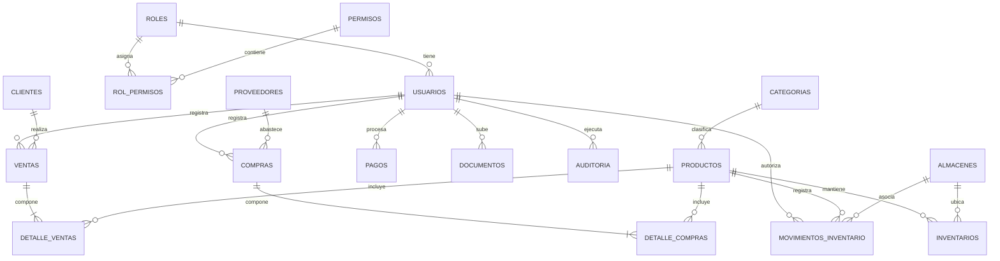

# ERP EnterpriseCloud - Diseño y Diccionario de Base de Datos

## 1. Diagrama Entidad - Relación (DER)

---

## 2. Diccionario de Datos

### Tabla: `usuarios`
| Campo | Tipo | Restricción | Descripción |
|---|---|---|---|
| `id` | SERIAL / INT | PK, Auto | Identificador único del usuario |
| `username` | VARCHAR(50) | NOT NULL, UNIQUE | Nombre de usuario para login |
| `email` | VARCHAR(100) | NOT NULL, UNIQUE | Correo corporativo |
| `hashed_password` | VARCHAR(255) | NOT NULL | Hash criptográfico de contraseña |
| `full_name` | VARCHAR(100) | NOT NULL | Nombre y apellidos del usuario |
| `role_id` | INT | NOT NULL, FK | Referencia al rol asignado |
| `is_active` | BOOLEAN | DEFAULT TRUE | Estado de la cuenta (activo/inactivo) |
| `created_at` | TIMESTAMPTZ | DEFAULT NOW() | Fecha y hora de alta |

### Tabla: `clientes`
| Campo | Tipo | Restricción | Descripción |
|---|---|---|---|
| `id` | SERIAL / INT | PK, Auto | Identificador del cliente |
| `document_type` | VARCHAR(20) | NOT NULL | RUC, DNI, NIT, Pasaporte |
| `document_number`| VARCHAR(30) | NOT NULL, UNIQUE | Número de identificación tributaria |
| `name` | VARCHAR(150) | NOT NULL | Razón social o nombres y apellidos |
| `credit_limit` | NUMERIC(12,2)| DEFAULT 0.00 | Línea máxima de crédito otorgada |
| `current_balance`| NUMERIC(12,2)| DEFAULT 0.00 | Saldo adeudado acumulado (CxC) |

### Tabla: `productos`
| Campo | Tipo | Restricción | Descripción |
|---|---|---|---|
| `id` | SERIAL / INT | PK, Auto | Identificador del producto |
| `code` | VARCHAR(50) | NOT NULL, UNIQUE | Código SKU o código de barra |
| `name` | VARCHAR(150) | NOT NULL | Denominación comercial |
| `purchase_price` | NUMERIC(12,2)| NOT NULL | Costo promedio de adquisición |
| `sale_price` | NUMERIC(12,2)| NOT NULL | Precio de venta estándar sin/con IGV |
| `min_stock` | NUMERIC(10,2)| DEFAULT 5.00 | Umbral de alerta para reposición |

### Tabla: `movimientos_inventario` (Kardex)
| Campo | Tipo | Restricción | Descripción |
|---|---|---|---|
| `id` | SERIAL / INT | PK, Auto | Identificador del asiento de Kardex |
| `product_id` | INT | NOT NULL, FK | Producto involucrado |
| `warehouse_id` | INT | NOT NULL, FK | Almacén donde ocurre el movimiento |
| `movement_type` | VARCHAR(30) | NOT NULL | ENTRADA, SALIDA, AJUSTE, TRANSFERENCIA |
| `quantity` | NUMERIC(12,2)| NOT NULL | Unidades del movimiento |
| `previous_stock`| NUMERIC(12,2)| NOT NULL | Existencia previa a la operación |
| `new_stock` | NUMERIC(12,2)| NOT NULL | Existencia posterior calculada |
| `reference_type`| VARCHAR(50) | NULL | VENTA, COMPRA, AJUSTE, INICIAL |

### Tabla: `documentos` (Cloud S3)
| Campo | Tipo | Restricción | Descripción |
|---|---|---|---|
| `id` | SERIAL / INT | PK, Auto | Identificador del documento |
| `entity_type` | VARCHAR(50) | NOT NULL | Módulo asociado (VENTAS, COMPRAS, etc.) |
| `entity_id` | INT | NOT NULL | Identificador del registro vinculado |
| `filename` | VARCHAR(255) | NOT NULL | Nombre interno único del archivo |
| `original_name` | VARCHAR(255) | NOT NULL | Nombre de archivo subido por el usuario |
| `s3_bucket` | VARCHAR(100) | NULL | Bucket de Amazon S3 donde reside |
| `s3_key` | VARCHAR(255) | NULL | Ruta o clave del objeto dentro del bucket |
| `file_url` | VARCHAR(500) | NULL | URL de acceso seguro al archivo |
