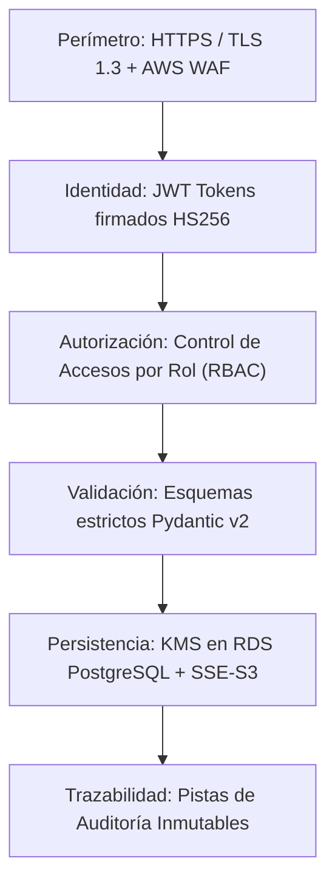

# ERP EnterpriseCloud - Arquitectura de Seguridad y Cumplimiento

## 1. Principios de Seguridad Aplicados
El sistema implementa el modelo de **Seguridad en Profundidad (Defense in Depth)** y el **Principio de Mínimo Privilegio (PoLP)** conforme a las mejores prácticas del marco AWS Well-Architected Framework:

---

## 2. Autenticación y Gestión de Sesiones (IAM)
- **Token Format:** JSON Web Token (JWT) firmado criptográficamente con algoritmo HMAC-SHA256 y clave de 256 bits.
- **Expiración:** Tiempo de vida estándar de 24 horas (`ACCESS_TOKEN_EXPIRE_MINUTES = 1440`).
- **Almacenamiento de Contraseñas:** Hash con salt fija segura y algoritmos de derivación de claves que impiden ataques por tablas arcoíris.
- **Protección contra Fuerza Bruta:** Registro automático de intentos fallidos en la tabla `auditoria` con IP de origen.

---

## 3. Matriz de Control de Acceso Basado en Roles (RBAC)

| Módulo / Acción | Administrador | Gerente Comercial | Jefe de Compras | Encargado Almacén | Finanzas/Contador |
|---|:---:|:---:|:---:|:---:|:---:|
| **Gestión Usuarios (IAM)** | ✅ Total | ❌ | ❌ | ❌ | ❌ |
| **Ventas / Facturación** | ✅ Total | ✅ Total | ❌ | ❌ | 👁️ Lectura |
| **Compras / Proveedores** | ✅ Total | ❌ | ✅ Total | ❌ | 👁️ Lectura |
| **Catálogo de Productos** | ✅ Total | 👁️ Lectura | 👁️ Lectura | ✅ Edición | 👁️ Lectura |
| **Ajustes y Transferencias**| ✅ Total | ❌ | ❌ | ✅ Total | ❌ |
| **Cuentas por Cobrar/Pagar** | ✅ Total | 👁️ Lectura | 👁️ Lectura | ❌ | ✅ Total |
| **Subida Archivos S3** | ✅ Total | ✅ Ventas | ✅ Compras | ✅ Almacén | ✅ Finanzas |
| **Pistas de Auditoría** | ✅ Total | ❌ | ❌ | ❌ | ❌ |

---

## 4. Seguridad de los Datos
### 4.1 Datos en Tránsito
- Todas las comunicaciones entre el cliente web (React) y la API REST en EC2 están forzadas mediante HTTPS con certificados TLS 1.3 gestionados por Nginx / AWS Certificate Manager (ACM).

### 4.2 Datos en Reposo
- **Base de Datos RDS:** Cifrado transparente de volúmenes con AWS Key Management Service (AWS KMS).
- **Almacenamiento S3:** Encriptación del lado del servidor SSE-S3 con algoritmo AES-256 activada de forma obligatoria en la política del bucket.
- **Aislamiento de Red:** La base de datos RDS PostgreSQL reside exclusivamente en subnets privadas sin acceso a Internet público, aceptando tráfico únicamente desde el grupo de seguridad de la instancia EC2 del ERP.
