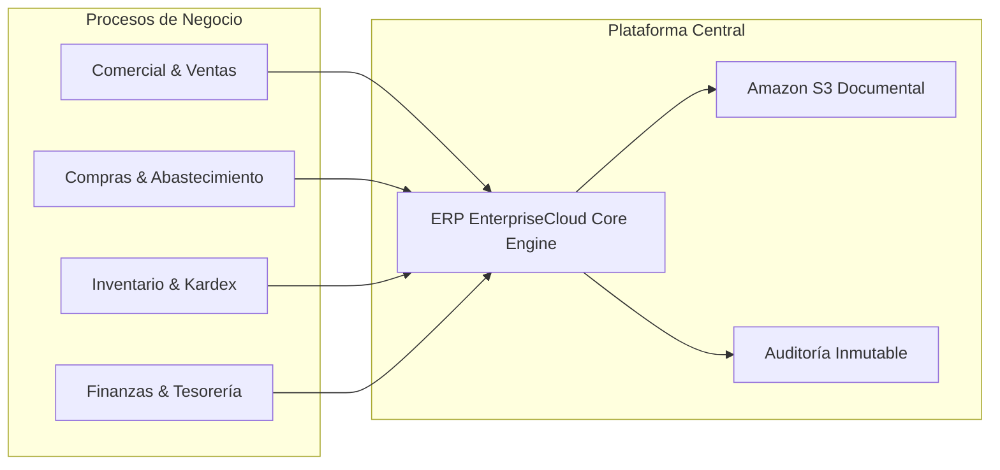
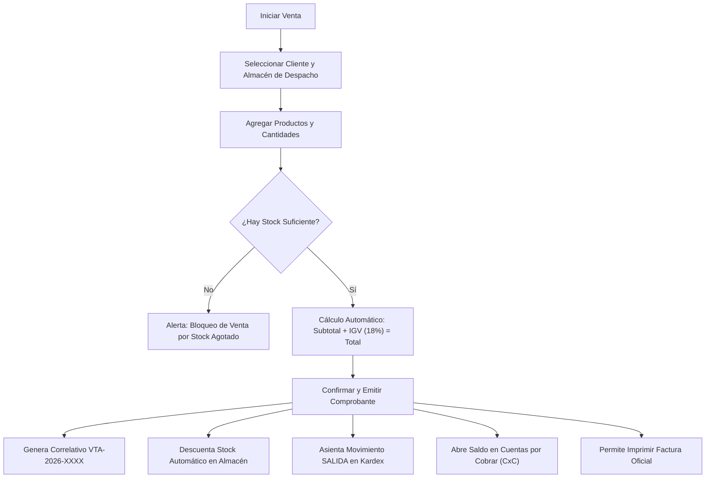
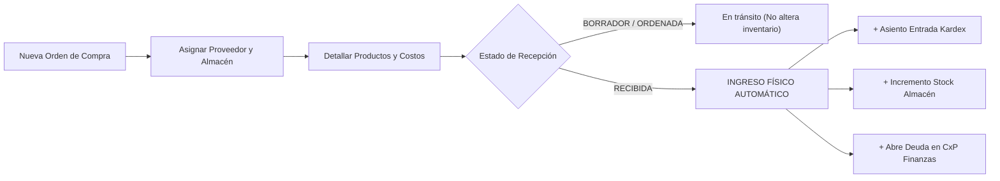
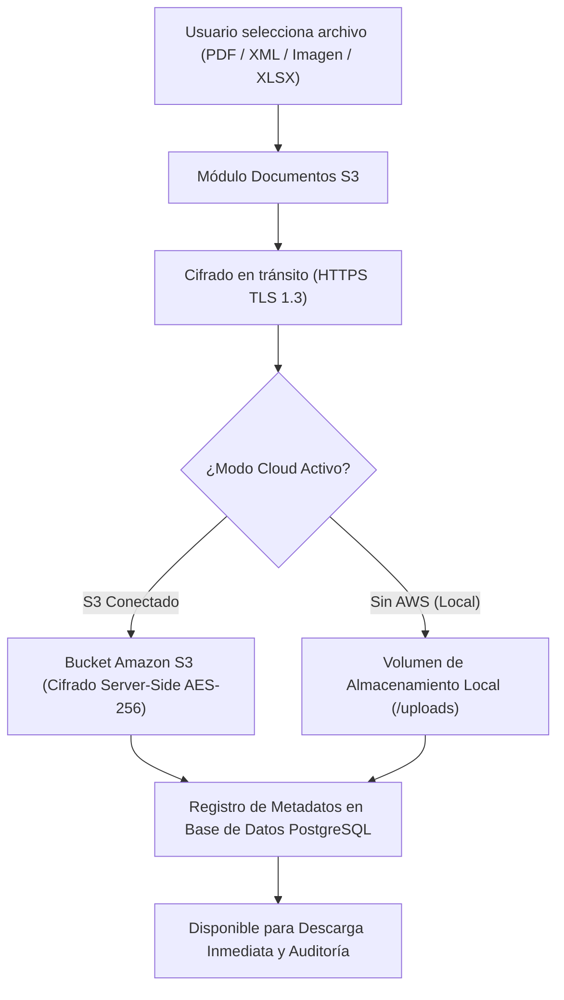
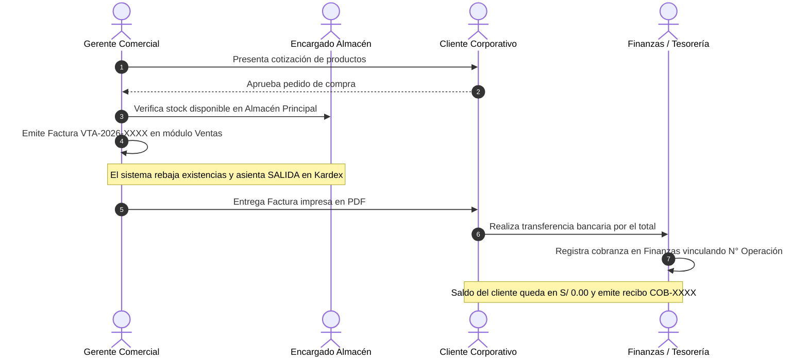

# Manual de Usuario - ERP EnterpriseCloud
## Sistema Integrado de Gestión Empresarial en la Nube
### Versión del Documento: 2.5 (Edición Corporativa) · Código: MAN-USR-ERP-2026-v2.5

---

```
  ███████╗██████╗ ██████╗     ███████╗███╗   ██╗████████╗███████╗██████╗ ██████╗ ██████╗ ██╗███████╗███████╗
  ██╔════╝██╔══██╗██╔══██╗    ██╔════╝████╗  ██║╚══██╔══╝██╔════╝██╔══██╗██╔══██╗██╔══██╗██║██╔════╝██╔════╝
  █████╗  ██████╔╝██████╔╝    █████╗  ██╔██╗ ██║   ██║   █████╗  ██████╔╝██████╔╝██████╔╝██║███████╗█████╗  
  ██╔══╝  ██╔══██╗██╔═══╝     ██╔══╝  ██║╚██╗██║   ██║   ██╔══╝  ██╔══██╗██╔═══╝ ██╔══██╗██║╚════██║██╔══╝  
  ███████╗██║  ██║██║         ███████╗██║ ╚████║   ██║   ███████╗██║  ██║██║     ██║  ██║██║███████║███████╗
  ╚══════╝╚═╝  ╚═╝╚═╝         ╚══════╝╚═╝  ╚═══╝   ╚═╝   ╚══════╝╚═╝  ╚═╝╚═╝     ╚═╝  ╚═╝╚═╝╚══════╝╚══════╝
```

---

## 📑 Control de Documento

| Atributo | Detalle |
| :--- | :--- |
| **Título del Documento** | Manual de Usuario Operativo y Administrativo |
| **Nombre del Sistema** | ERP EnterpriseCloud (Amazon Web Services Edition) |
| **Código del Manual** | `MAN-USR-ERP-2026-v2.5` |
| **Versión del Software** | Release 2.5.0 (FastAPI 0.115 + React 18 + AWS Boto3) |
| **Fecha de Publicación** | Octubre 2026 |
| **Público Objetivo** | Usuarios Finales, Vendedores, Almaceneros, Compradores, Contadores y Administradores |
| **Clasificación de Seguridad** | Uso Interno / Confidencial |

---

## 📑 Tabla de Contenidos

1. [Introducción y Objetivos del ERP](#1-introducción-y-objetivos-del-erp)
2. [Requisitos Técnicos y Entorno Operativo](#2-requisitos-técnicos-y-entorno-operativo)
3. [Seguridad y Control de Acceso (Autenticación JWT)](#3-seguridad-y-control-de-acceso-autenticación-jwt)
4. [Matriz de Roles y Permisos (RBAC)](#4-matriz-de-roles-y-permisos-rbac)
5. [Estructura Visual y Navegación de la Interfaz](#5-estructura-visual-y-navegación-de-la-interfaz)
6. [Módulo 1: Dashboard Ejecutivo & KPIs en Tiempo Real](#6-módulo-1-dashboard-ejecutivo--kpis-en-tiempo-real)
7. [Módulo 2: Gestión de Clientes (Cartera Comercial)](#7-módulo-2-gestión-de-clientes-cartera-comercial)
8. [Módulo 3: Comercial & Ventas (Facturación y Salidas)](#8-módulo-3-comercial--ventas-facturación-y-salidas)
9. [Módulo 4: Gestión de Proveedores](#9-módulo-4-gestión-de-proveedores)
10. [Módulo 5: Compras & Adquisiciones (Entradas a Almacén)](#10-módulo-5-compras--adquisiciones-entradas-a-almacén)
11. [Módulo 6: Inventario, Almacenes y Kardex Permanente](#11-módulo-6-inventario-almacenes-y-kardex-permanente)
12. [Módulo 7: Finanzas, Tesorería y Cobranzas (CxC / CxP)](#12-módulo-7-finanzas-tesorería-y-cobranzas-cxc--cxp)
13. [Módulo 8: Repositorio Cloud de Documentos (Amazon S3)](#13-módulo-8-repositorio-cloud-de-documentos-amazon-s3)
14. [Módulo 9: Auditoría & Trazabilidad Inmutable](#14-módulo-9-auditoría--trazabilidad-inmutable)
15. [Módulo 10: Administración del Sistema e IAM](#15-módulo-10-administración-del-sistema-e-iam)
16. [Flujos Operativos Integrados de Extremo a Extremo (E2E)](#16-flujos-operativos-integrados-de-extremo-a-extremo-e2e)
17. [Preguntas Frecuentes y Solución de Problemas (FAQ)](#17-preguntas-frecuentes-y-solución-de-problemas-faq)
18. [Glosario de Términos Empresariales](#18-glosario-de-términos-empresariales)
19. [Mesa de Ayuda y Soporte Técnico](#19-mesa-de-ayuda-y-soporte-técnico)

---

## 1. Introducción y Objetivos del ERP

### 1.1 ¿Qué es ERP EnterpriseCloud?
**ERP EnterpriseCloud** es una plataforma integral de gestión empresarial diseñada bajo arquitectura desacoplada de alto rendimiento en la nube. Conecta en tiempo real las operaciones de ventas, abastecimiento logístico, control permanente de existencias multialmacén, tesorería financiera, gestión documental cifrada en la nube y auditoría continua inmutable.

### 1.2 Principios Operativos del Sistema
* **Trazabilidad Absoluta:** Toda transacción económica o movimiento de almacén genera un registro auditable no editable.
* **Integración Atómica:** La emisión de una factura rebaja automáticamente las existencias en Kardex y actualiza la cuenta por cobrar del cliente de manera simultánea.
* **Cero Papel:** Documentación tributaria, comprobantes de pago y órdenes se resguardan digitalmente con almacenamiento elástico en Amazon S3.
* **Control Multialmacén:** Visualización inmediata de existencias distribuidas y transferencias interalmacenes seguras.



---

## 2. Requisitos Técnicos y Entorno Operativo

### 2.1 Requisitos del Navegador Web
El sistema está construido como una Single Page Application (SPA) compatible con los navegadores modernos estándar:
* **Google Chrome:** Versión 100 o superior (Recomendado).
* **Microsoft Edge:** Versión 100 o superior.
* **Mozilla Firefox:** Versión 95 o superior.
* **Apple Safari:** Versión 15 o superior.
* **Resolución recomendada:** 1366 × 768 píxeles en adelante (Optimizado para monitores Full HD 1080p).

> [!NOTE]
> No se requiere instalar extensiones, applets de Java ni complementos ActiveX. Toda la comunicación se realiza vía protocolo HTTPS seguro.

### 2.2 Acceso al Entorno
* **Entorno de Red Local / Desarrollo:** `http://localhost:3000`
* **Entorno de Producción Cloud:** `https://erp.tu-empresa.com` (o la IP pública elástica asignada en AWS EC2).

---

## 3. Seguridad y Control de Acceso (Autenticación JWT)

### 3.1 Proceso de Inicio de Sesión
1. Abra el navegador web y diríjase a la URL del ERP.
2. La pantalla de bienvenida mostrará el formulario de inicio de sesión con el logotipo corporativo.
3. Ingrese su **Nombre de Usuario** o **Correo Electrónico Corporativo**.
4. Ingrese su **Contraseña**.
5. Haga clic en el botón **Ingresar al ERP**.

```
┌─────────────────────────────────────────────────────────────┐
│                 🔐 ERP EnterpriseCloud                      │
│                  Acceso al Sistema                          │
│                                                             │
│   Usuario o Email:  [ admin                       ]         │
│   Contraseña:       [ ••••••••••                  ]         │
│                                                             │
│                [   INGRESAR AL ERP   ]                      │
│                                                             │
│   💡 Demo: admin / admin123 (Administrador Global)         │
└─────────────────────────────────────────────────────────────┘
```

> [!TIP]
> **Credenciales de Arranque (Entorno de Pruebas):**
> * **Usuario:** `admin`
> * **Contraseña:** `admin123`

### 3.2 Manejo de Tokens de Sesión y Seguridad
* Tras la validación criptográfica (Bcrypt / SHA-256), el sistema expide un token **JSON Web Token (JWT)** con vigencia temporal.
* El token almacena su identidad y rol autorizado.
* Si el sistema permanece inactivo o el token caduca, la aplicación redirigirá automáticamente a la pantalla de login para salvaguardar la información empresarial.

### 3.3 Cierre de Sesión Seguro
Para finalizar su jornada de trabajo de forma segura:
1. Ubique en la barra lateral inferior el bloque con su nombre y rol.
2. Haga clic en el botón con ícono de salida **Cerrar Sesión** (color rojo).
3. El token local será purgado del navegador y se registrará el evento de desconexión en el módulo de auditoría.

---

## 4. Matriz de Roles y Permisos (RBAC)

El sistema utiliza un modelo de **Control de Acceso Basado en Roles (RBAC)** estricto. La tabla describe los privilegios por perfil:

| Módulo / Función | Administrador | Gerente Comercial | Jefe de Compras | Encargado Almacén | Finanzas / Contabilidad |
| :--- | :---: | :---: | :---: | :---: | :---: |
| **Dashboard Ejecutivo** | ✅ Lectura / Control | ✅ Lectura | ✅ Lectura | ✅ Alertas Stock | ✅ KPIs Financieros |
| **Cartera de Clientes** | ✅ Total | ✅ Alta / Modificación | ❌ Solo consulta | ❌ Sin acceso | ✅ Consulta de saldo |
| **Ventas y Facturación** | ✅ Total / Anulación | ✅ Emisión / Anulación | ❌ Sin acceso | ❌ Sin acceso | ✅ Consulta / Facturas |
| **Cartera de Proveedores**| ✅ Total | ❌ Sin acceso | ✅ Alta / Modificación | ❌ Sin acceso | ✅ Consulta de saldo |
| **Compras y Órdenes OC** | ✅ Total | ❌ Sin acceso | ✅ Emisión y Recepción | ❌ Consulta recepción | ✅ Consulta CxP |
| **Catálogo de Productos**| ✅ Total | 👁️ Solo consulta | 👁️ Solo consulta | ✅ Modificación / SKU | 👁️ Solo consulta |
| **Kardex y Transferencias**| ✅ Total | ❌ Sin acceso | ❌ Sin acceso | ✅ Operación Total | 👁️ Solo lectura |
| **Finanzas (CxC / CxP)** | ✅ Total | 👁️ Ver cartera propia | 👁️ Ver compras | ❌ Sin acceso | ✅ Registro Cobros/Pagos |
| **Archivos Cloud (S3)** | ✅ Subida / Borrado | ✅ Subir comprobantes | ✅ Subir órdenes | ✅ Guías de remisión | ✅ Vouchers bancarios |
| **Log de Auditoría** | ✅ Consulta y Exportación | ❌ Sin acceso | ❌ Sin acceso | ❌ Sin acceso | 👁️ Auditoría contable |
| **Gestión de Usuarios IAM**| ✅ Total | ❌ Sin acceso | ❌ Sin acceso | ❌ Sin acceso | ❌ Sin acceso |

---

## 5. Estructura Visual y Navegación de la Interfaz

La pantalla principal del ERP está organizada de manera ergonómica e intuitiva:

```
┌────────────────────────────────────────────────────────────────────────────────────────┐
│ [Logo ERP]  EnterpriseCloud             [☀️ / 🌙 Tema]  [🔔 Notificaciones] [👤 Usuario]│
├─────────────────┬──────────────────────────────────────────────────────────────────────┤
│ 📊 Dashboard    │                                                                      │
│ 👥 Clientes     │  ÁREA DE TRABAJO DINÁMICA                                            │
│ 🛒 Ventas       │                                                                      │
│ 🏭 Proveedores  │  Aquí se despliegan las tablas interactivas, formularios de captura, │
│ 📦 Compras      │  gráficos de tendencias, modales de confirmación y visores de        │
│ 📦 Inventario   │  documentos según el módulo seleccionado en el menú lateral.         │
│ 💰 Finanzas     │                                                                      │
│ ☁️ Documentos S3│                                                                      │
│ 🛡️ Auditoría    │                                                                      │
│ ⚙️ Usuarios     │                                                                      │
│                 │                                                                      │
│ [🚪 Salir]      │                                                                      │
└─────────────────┴──────────────────────────────────────────────────────────────────────┘
```

### Componentes de la Interfaz
1. **Barra Lateral Izquierda (Sidebar):** Permite navegar entre los 10 módulos del sistema. Muestra íconos distintivos y resalta la pestaña activa.
2. **Selector de Tema Visual (Modo Oscuro / Modo Claro):** Ubicado en la barra superior; permite alternar entre modo oscuro (Dark Mode de alto contraste) y modo claro profesional con un solo clic.
3. **Indicador de Usuario Activo:** Muestra el nombre del operador autenticado y la insignia de su rol actual.
4. **Área de Contenido:** Espacio central donde se ejecutan las operaciones, se aplican filtros de búsqueda en vivo y se exportan reportes en formato CSV.

---

## 6. Módulo 1: Dashboard Ejecutivo & KPIs en Tiempo Real

El **Dashboard Ejecutivo** es la torre de control de la empresa. Consolida la salud financiera, operativa y comercial al instante.

### 6.1 Tarjetas de Indicadores Clave (KPIs)
* **Ventas Facturadas:** Importe neto acumulado de ventas en estado `FACTURADA` (expresado en Soles S/).
* **Compras Ejecutadas:** Total gastado en adquisiciones a proveedores homologados.
* **Cuentas por Cobrar (CxC):** Dinero pendiente de pago por clientes con facturas emitidas.
* **Alertas de Stock:** Cantidad de artículos que se encuentran en o por debajo del umbral mínimo de seguridad.

### 6.2 Gráfico de Tendencia Mensual
Presenta una comparativa visual interactiva de **Ingresos vs. Egresos**:
* Barras Azules/Verdes: Facturación bruta mensual.
* Barras Naranjas/Rojas: Compras y adquisiciones del periodo.
* Permite al directorio evaluar el margen operativo del negocio mes a mes.

### 6.3 Monitor de Alertas de Stock Crítico
Muestra de forma destacada los productos con existencias comprometidas:
* **Insignia Roja (AGOTADO):** Stock = 0 unidades. Requiere orden de reposición inmediata.
* **Insignia Amarilla (STOCK BAJO):** Stock ≤ Stock Mínimo.
* **Insignia Verde (STOCK NORMAL):** Existencias saludables en almacenes.

### 6.4 Generador de Datos de Demostración (Seed Demo)
Para fines de capacitación de nuevos colaboradores o demostraciones ejecutivas:
1. En la parte superior derecha del Dashboard, ubique el botón **Generar Datos de Demostración**.
2. Al presionarlo, el sistema poblará automáticamente categorías, clientes, proveedores, catálogo informático (Laptops, iPhones, Monitores 4K, CPUs Intel), órdenes de compra con ingreso a Kardex, comprobantes de venta y cobranzas bancarias.
3. Si desea vaciar los datos de prueba, utilice el botón **Limpiar Base de Datos**.

---

## 7. Módulo 2: Gestión de Clientes (Cartera Comercial)

Permite centralizar el catálogo de personas naturales y jurídicas a las que la empresa factura productos o servicios.

### 7.1 Registro de un Nuevo Cliente
1. Haga clic en **Clientes** en el menú de navegación.
2. Presione el botón **+ Nuevo Cliente**.
3. Se abrirá la ventana modal de captura con los siguientes campos:
   * **Tipo de Documento:** Seleccione `RUC` (empresas) o `DNI` (personas naturales).
   * **Número de Documento:** Ingrese el RUC de 11 dígitos o DNI de 8 dígitos.
   * **Razón Social / Nombre Completo:** Denominación legal del cliente.
   * **Correo Electrónico:** Para envío de cotizaciones y facturas.
   * **Teléfono / Móvil:** Canal de contacto del cliente.
   * **Dirección Fiscal / Despacho:** Lugar de entrega de mercancías.
   * **Límite de Crédito (S/):** Cupo máximo permitido para compras al crédito.
4. Haga clic en **Guardar Cliente**.

### 7.2 Consulta de Saldos y Cuentas Corrientes
* La tabla presenta la columna **Saldo Deudor Actual (S/)**.
* Si el cliente tiene ventas facturadas no saldadas, el importe figurará resaltado en color naranja/rojo.
* Al presionar el botón de cobro rápido, el sistema enlaza directamente con el módulo de finanzas para asentar el abono bancario.

---

## 8. Módulo 3: Comercial & Ventas (Facturación y Salidas)

Permite la emisión de comprobantes de pago comerciales y la gestión del ciclo completo de ventas.



### 8.1 Emisión Paso a Paso de una Factura / Venta
1. Ingrese a **Comercial & Ventas**.
2. Haga clic en el botón azul **+ Nueva Venta / Factura**.
3. Complete los datos de la cabecera:
   * **Cliente:** Seleccione el cliente registrado de la lista desplegable.
   * **Almacén de Despacho:** Seleccione el almacén físico desde el cual saldrá la mercadería (ej. *Almacén Principal Lima* o *Almacén Secundario*).
   * **Estado:** Seleccione `FACTURADA` (genera salida física y compromiso de cobro), `PEDIDO` o `COTIZACION`.
   * **Notas / Glosa:** Comentarios adicionales (ej. *Orden de Compra Cliente N° 45892*).
4. Agregue los productos a la grilla de detalle:
   * Seleccione el **Producto** mediante el selector. El sistema cargará el precio de venta sugerido y el stock disponible actual en el almacén seleccionado.
   * Modifique la **Cantidad** con los botones `+` / `-` o digitando directamente.
   * Si la cantidad ingresada supera el stock físico disponible en el almacén, el sistema emitirá una alerta visible en pantalla e impedirá la emisión hasta ajustar el valor.
   * Ajuste el **Precio Unitario** de ser necesario (descuentos acordados).
   * Presione **+ Agregar Producto** para incluir más líneas de venta.
5. Verifique el desglose económico al pie del formulario:
   * **Subtotal:** Base imponible.
   * **IGV (18%):** Impuesto General a las Ventas calculado automáticamente.
   * **Total a Pagar:** Importe final neto a cobrar.
6. Haga clic en **Emitir Comprobante de Venta**.
7. Inmediatamente el sistema mostrará la **Vista Previa de Impresión de Factura**.

### 8.2 Impresión de Comprobantes de Venta
* En la tabla de ventas, cada registro dispone del ícono de **Impresora / Ver Factura**.
* El modal de impresión genera una factura formal con:
  * Razón social, RUC y dirección de la empresa emisora.
  * Número de comprobante correlativo (ej. `VTA-2026-0001`).
  * Datos fiscales del cliente adquiriente.
  * Tabla con descripción, unidad de medida, cantidad, valor unitario e importe total.
  * Resumen de impuestos y leyenda legal.
* Puede enviarse directamente a cualquier impresora física o guardarse como archivo **PDF**.

### 8.3 Anulación de una Venta
Si una venta fue registrada por equivocación:
1. En la tabla de comprobantes, ubique el registro correspondiente.
2. Haga clic en el ícono de **Prohibido / Anular (Color Rojo)**.
3. El sistema solicitará confirmación explicando el impacto:
   > *"¿Está seguro de anular esta venta? Se restituirá el stock al almacén original y se rebajará el saldo de la cuenta por cobrar del cliente."*
4. Al confirmar, el comprobante cambiará su estado a `ANULADA` y se generará una entrada de restitución en el Kardex.

### 8.4 Exportación a Excel / CSV
Haga clic en el botón **Exportar a CSV** para descargar la relación de todas las ventas con sus importes, impuestos, estado y clientes para su consolidación contable.

---

## 9. Módulo 4: Gestión de Proveedores

Permite administrar la base de datos de socios comerciales que proveen materia prima, mercadería o servicios a la empresa.

### 9.1 Registro de un Proveedor
1. Diríjase a **Proveedores** en el menú lateral.
2. Haga clic en **+ Nuevo Proveedor**.
3. Ingrese los datos fiscales:
   * **RUC:** Número de registro tributario de 11 dígitos.
   * **Razón Social:** Nombre legal de la empresa proveedora.
   * **Persona de Contacto:** Ejecutivo de cuenta o vendedor asignado.
   * **Email y Teléfono:** Vías formales de comunicación.
   * **Dirección:** Domicilio fiscal o planta de despacho.
   * **Límite de Crédito:** Línea de financiamiento otorgada.
4. Presione **Guardar Proveedor**.

### 9.2 Control de Saldos por Pagar
La tabla exhibe el **Saldo por Pagar (S/)** en tiempo real. Este importe se incrementa cuando se recepciona una orden de compra y se reduce cuando se emite un comprobante de egreso bancario.

---

## 10. Módulo 5: Compras & Adquisiciones (Entradas a Almacén)

Gestiona las solicitudes de aprovisionamiento a proveedores y la incorporación formal de mercadería a las bodegas de la empresa.



### 10.1 Registro y Recepción de Orden de Compra (OC)
1. Ingrese a **Compras & Adquisiciones**.
2. Presione **+ Nueva Orden de Compra**.
3. Complete los campos requeridos:
   * **Proveedor:** Seleccione el proveedor homologado.
   * **Almacén Destino:** Bodega física donde se descargará el pedido.
   * **Estado:**
     * `ORDENADA`: Pedido cursado al proveedor pero aún en tránsito.
     * `RECIBIDA`: La mercadería llegó al almacén, fue inspeccionada y aceptada por el encargado.
   * **Notas:** Número de guía de remisión del transportista o factura del proveedor.
4. Agregue los productos adquiridos:
   * Seleccione los productos solicitados.
   * Indique la cantidad ingresada y el **Costo Unitario de Adquisición**.
5. Presione **Confirmar Adquisición / Orden**.

> [!IMPORTANT]
> Cuando una orden pasa al estado **RECIBIDA**, el sistema ejecuta una transacción que:
> 1. Suma las cantidades físicas al stock del almacén destino.
> 2. Registra los asientos individuales de `ENTRADA` en el Kardex permanente valorizado.
> 3. Registra la obligación en el módulo de Cuentas por Pagar (CxP).

---

## 11. Módulo 6: Inventario, Almacenes y Kardex Permanente

El módulo de inventarios es el corazón logístico del ERP. Opera bajo la modalidad de **Inventario Permanente Multialmacén**.

Dispone de 4 pestañas especializadas:
1. **Catálogo de Productos**
2. **Stock por Almacén**
3. **Kardex Permanente**
4. **Operaciones Especiales (Ajustes y Transferencias)**

---

### 11.1 Catálogo de Productos y Registro de Nuevos Artículos
Permite dar de alta SKUs con su estructura de costos y precios de venta.

#### Pasos para Crear un Producto:
1. En la pestaña **Catálogo**, haga clic en **+ Nuevo Producto**.
2. Ingrese la información requerida:
   * **Código SKU:** Identificador único (ej. `LAP-HP-002`, `MON-SAMS-27`).
   * **Nombre del Producto:** Denominación clara del artículo.
   * **Categoría:** Elija el rubro (Laptops, Smartphones, Monitores, Componentes, etc.).
   * **Unidad de Medida:** `UND` (unidades), `KG` (kilogramos), `MTR` (metros), `CJ` (cajas).
   * **Precio de Compra / Costo Base (S/):** Costo estándar de adquisición sin impuestos.
   * **Precio de Venta al Público (S/):** Valor de comercialización sugerido.
   * **Stock Mínimo de Seguridad:** Cantidad umbral para detonar alertas preventivas.
3. Presione **Guardar Producto**.

#### Ingreso Rápido de Stock (+ Entrada Rápida):
En la tarjeta de cada producto en el catálogo, existe el botón **+ Stock Rápido**:
* Permite cargar existencias inmediatas sin pasar por una orden de compra formal (útil para inventario inicial o muestras comerciales).
* Solicita: Almacén destino, Cantidad y Motivo justificado.

---

### 11.2 Stock por Almacén
Permite monitorear las existencias desglosadas por cada recinto físico o depósito:
* Visualiza el stock específico de cada SKU en el **Almacén Principal**, **Almacén Secundario** o almacenes regionales.
* Permite filtrar por almacén y buscar rápidamente por nombre o SKU.

---

### 11.3 Kardex Permanente Multialmacén
Es el libro contable de movimientos de mercadería. Registra cada ingreso y egreso con estricta trazabilidad cronológica:
* **Fecha y Hora Exacta:** Momento de la operación.
* **Producto y Código SKU:** Ítem involucrado.
* **Almacén:** Depósito afectado.
* **Tipo de Movimiento:**
  * `ENTRADA`: Compras recibidas, ajustes positivos, recepciones por transferencia.
  * `SALIDA`: Ventas facturadas, mermas, despachos por transferencia.
  * `AJUSTE`: Regularización de stock por conteo físico.
* **Cantidad:** Magnitud de la variación.
* **Saldo Resultante:** Existencia física que queda inmediatamente después del evento.
* **Referencia y Usuario:** Número de documento vinculado (`VTA-001`, `CMP-002`, `TRF-001`) y operador responsable.

---

### 11.4 Operaciones Especiales: Transferencias y Ajustes

```
┌──────────────────────────────────────────────┐  ┌──────────────────────────────────────────────┐
│        🔄 Transferencia Interalmacén         │  │         ⚖️ Ajuste Manual de Inventario       │
│                                              │  │                                              │
│ Producto:       [ Laptop HP Pavilion       ] │  │ Producto:       [ iPhone 15 Pro          ] │
│ Almacén Origen: [ Almacén Principal Lima   ] │  │ Almacén:        [ Almacén Principal Lima ] │
│ Almacén Destino:[ Almacén Secundario Sur   ] │  │ Tipo:           [ ENTRADA / SALIDA       ] │
│ Cantidad:       [ 5                        ] │  │ Cantidad:       [ 2                      ] │
│                                              │  │ Motivo:         [ Conteo Físico Mensual  ] │
│       [ EJECUTAR TRANSFERENCIA SEGURA ]      │  │           [ REGISTRAR AJUSTE KARDEX ]      │
└──────────────────────────────────────────────┘  └──────────────────────────────────────────────┘
```

#### A. Transferencia entre Almacenes:
1. Vaya a la subpestaña **Operaciones** e identifique la sección **Transferencia entre Almacenes**.
2. Seleccione el **Producto**, el **Almacén de Origen** y el **Almacén de Destino**.
3. Ingrese la cantidad a trasladar.
4. Haga clic en **Ejecutar Transferencia**.
5. El sistema efectúa una **doble transacción atómica**:
   * Asiento 1: Salida (-Q) en el Almacén Origen.
   * Asiento 2: Entrada (+Q) en el Almacén Destino.
   * Ambos asientos quedan enlazados en el Kardex para auditorías.

#### B. Ajuste Manual por Conteo Físico o Merma:
1. En la misma pestaña, ubique **Ajuste Manual de Inventario**.
2. Seleccione el producto y el almacén a regularizar.
3. Elija el tipo de ajuste:
   * `ENTRADA`: Si el conteo físico arrojó más existencias de las registradas en el sistema.
   * `SALIDA`: Si se detectó faltante, merma justificada o rotura.
4. Especifique la cantidad y redacte una justificación obligatoria en las **Notas** (ej. *Acta de Conteo Físico Trimestral N° 04*).
5. Confirme presionando **Aplicar Ajuste de Inventario**.

---

## 12. Módulo 7: Finanzas, Tesorería y Cobranzas (CxC / CxP)

Controla los flujos de dinero entrante y saliente, garantizando la solvencia y liquidación oportuna de obligaciones comerciales.

### 12.1 Cuentas por Cobrar (CxC - Clientes)
1. Ingrese a **Finanzas & Tesorería** y seleccione la pestaña **Cuentas por Cobrar (CxC)**.
2. Se listarán todos los clientes que mantienen saldos pendientes de pago por facturas emitidas.
3. Para asentar un abono:
   * Haga clic en el botón verde **Registrar Cobranza** junto al cliente.
   * El sistema abrirá la ventana de liquidación precargando el saldo pendiente.
   * Ingrese el monto efectivamente cancelado (permite pagos parciales o cancelación total).
   * Seleccione el **Medio de Pago**: `TRANSFERENCIA`, `DEPOSITO`, `YAPE`, `PLIN` o `EFECTIVO`.
   * Seleccione la **Cuenta Bancaria Destino** (ej. *BCP Soles Cta Cte 191-2384918-0-12*, *BBVA*, *Interbank* o *Scotiabank*).
   * Ingrese el **Número de Operación Bancaria** o referencia del voucher.
   * Haga clic en **Procesar Movimiento Financiero**.
4. El saldo deudor del cliente se rebajará instantáneamente y se generará un número correlativo de recibo (ej. `COB-2026-0001`).

### 12.2 Cuentas por Pagar (CxP - Proveedores)
1. Seleccione la pestaña **Cuentas por Pagar (CxP)**.
2. Identifique el proveedor al que se le cancelará una orden de compra o factura comercial.
3. Haga clic en **Emitir Pago**.
4. Ingrese el importe girado, cuenta bancaria de egreso, medio de pago y código de transferencia interbancaria.
5. Presione **Confirmar Pago**.
6. Se emitirá el comprobante de egreso correlativo (ej. `PAG-2026-0001`) y el saldo adeudado quedará actualizado.

### 12.3 Libro de Movimientos y Flujo de Caja
En la pestaña **Movimientos**, se visualiza el registro cronológico de todas las cobranzas (entradas en verde) y pagos a proveedores (salidas en rojo), permitiendo exportar el libro de bancos en formato CSV con un solo clic.

---

## 13. Módulo 8: Repositorio Cloud de Documentos (Amazon S3)

Garantiza la digitalización y respaldo seguro de documentos corporativos en la nube elástica de **Amazon Web Services (AWS S3)**.



### 13.1 Carga de Archivos a la Nube (Upload)
1. Diríjase a **Archivos Cloud (S3)** en el menú principal.
2. Presione el botón azul **+ Subir Archivo a S3**.
3. Complete los metadatos de clasificación:
   * **Entidad / Módulo Asociado:** Seleccione `VENTAS` (facturas electrónicas), `COMPRAS` (guías de proveedores), `CLIENTES` (fichas RUC, contratos) o `PRODUCTOS` (fichas técnicas, manuales).
   * **ID de Registro:** Ingrese el identificador del registro al que se vincula el archivo (ej. Venta ID `1`).
   * **Selección de Archivo:** Arrastre o seleccione el documento desde su computador (Formatos admitidos: `.pdf`, `.xml`, `.xlsx`, `.docx`, `.png`, `.jpg`).
4. Haga clic en **Transferir a S3**.
5. El archivo será encriptado con el algoritmo bancario **Server-Side Encryption (SSE-AES256)** y quedará indexado en la nube.

### 13.2 Consulta y Descarga Segura
* Cada documento muestra su nombre original, tamaño en kilobytes, fecha de carga y usuario que efectuó la transferencia.
* Para consultar el documento, haga clic en el botón azul **Descargar**.
* El sistema servirá el archivo directamente a través de una URL segura y firmada.

### 13.3 Eliminación de Documentos
Si un archivo fue cargado incorrectamente, el usuario autorizado (Administrador) puede hacer clic en el ícono de **Papelera** para remover tanto el blob en S3 como el registro relacional.

---

## 14. Módulo 9: Auditoría & Trazabilidad Inmutable

Cumple con los más altos estándares de control interno, gobierno corporativo y auditorías tributarias internacionales (SOX / ISO 27001).

### 14.1 ¿Qué Eventos se Registran?
Cada una de las siguientes operaciones genera un asiento **inmutable** (no editable ni eliminable) en la base de datos:
* **Accesos:** Inicios de sesión correctos y bloqueos por contraseña fallida (con IP y navegador).
* **Ventas:** Creación, facturación y anulación de comprobantes.
* **Inventario:** Entradas de mercadería, salidas de venta, transferencias interalmacén y ajustes manuales.
* **Finanzas:** Cobranzas recaudadas y desembolsos a proveedores.
* **Documental:** Carga y borrado de archivos en Amazon S3.
* **IAM:** Creación y modificación de privilegios de usuario.

### 14.2 Búsqueda y Filtrado Forense
1. Ingrese a **Auditoría & Trazabilidad**.
2. Puede filtrar las pistas por:
   * **Módulo:** Desplegable para aislar eventos de `VENTAS`, `COMPRAS`, `INVENTARIO`, `FINANZAS`, `DOCUMENTOS` o `IAM`.
   * **Buscador General:** Permite buscar por nombre de usuario (ej. *admin*, *carlos.mendoza*) o por detalle de operación.
3. Presione el botón **Exportar Pistas CSV** para generar el reporte de auditoría requerido por comités de control o entes fiscalizadores.

---

## 15. Módulo 10: Administración del Sistema e IAM

Permite la administración de cuentas de usuario, asignación de credenciales y gobierno de roles operativos. **Acceso exclusivo para el Administrador Global.**

### 15.1 Creación de un Nuevo Usuario Operador
1. En el menú lateral, seleccione **Administración & IAM**.
2. Presione el botón **+ Nuevo Usuario**.
3. Complete los campos del formulario:
   * **Nombre de Usuario:** Identificador para inicio de sesión (ej. `jtorres`, `mquispe`).
   * **Nombre Completo:** Nombres y apellidos del colaborador.
   * **Correo Corporativo:** Dirección de correo institucional.
   * **Contraseña:** Clave de acceso segura (mínimo 6 caracteres).
   * **Rol Asignado:** Seleccione uno de los 5 roles predefinidos:
     * `Administrador`
     * `Gerente Comercial`
     * `Jefe de Compras`
     * `Encargado de Almacén`
     * `Finanzas y Contabilidad`
4. Presione **Guardar Usuario**.

### 15.2 Estados de Cuenta y Desactivación
* En caso de cese o licencia de un empleado, el administrador puede cambiar el estado de la cuenta a `INACTIVO`.
* Las cuentas inactivas quedan automáticamente inhabilitadas para iniciar sesión en cualquier estación de trabajo.

---

## 16. Flujos Operativos Integrados de Extremo a Extremo (E2E)

A continuación se detallan los 3 ciclos operativos más comunes en la operativa diaria de la empresa:

### 16.1 Ciclo Completo de Venta y Cobranza (Order-to-Cash)


### 16.2 Ciclo de Abastecimiento y Recepción (Procure-to-Pay)
1. **Detección:** El Encargado de Almacén observa en el Dashboard la alerta amarilla de **Stock Bajo** en monitores 4K.
2. **Orden de Compra:** El Jefe de Compras ingresa a **Compras**, selecciona al proveedor homologado y emite una orden con estado `ORDENADA`.
3. **Recepción Física:** Días después, el transportista arriba al almacén con la mercadería. El encargado cuenta los bultos e inspecciona su estado.
4. **Ingreso al Sistema:** El Jefe de Compras edita la orden o genera la recepción con estado `RECIBIDA`. Inmediatamente el stock sube y se registra la entrada en el Kardex.
5. **Programación de Pago:** Finanzas visualiza la nueva obligación en **Cuentas por Pagar (CxP)** y programa la transferencia bancaria para la fecha de vencimiento acordada.

### 16.3 Reubicación de Existencias (Transferencia Interalmacenes)
1. La sucursal secundaria reporta alta demanda de procesadores Intel y falta de inventario local.
2. El Encargado de Almacén ingresa a **Inventario > Operaciones Especiales > Transferencia**.
3. Selecciona el ítem, marca como origen *Almacén Principal Lima* (con 20 unidades) y destino *Almacén Secundario Sur* (con 0 unidades).
4. Asigna 10 unidades y ejecuta la transferencia.
5. El sistema descuenta 10 unidades de Lima, añade 10 en la sede Sur y vincula ambos comprobantes con la referencia `TRANSFERENCIA`.

---

## 17. Preguntas Frecuentes y Solución de Problemas (FAQ)

### P1: Al intentar emitir una venta, el sistema muestra: "¡Stock insuficiente para el producto X! Solicitado: 5, Disponible: 2". ¿Cómo procedo?
> **Respuesta:** El sistema bloquea ventas sin existencias físicas para evitar quiebres de inventario o discrepancias contables. Para continuar:
> * Verifique si tiene stock del producto en otro almacén y efectúe una **Transferencia Interalmacén**.
> * O reduzca la cantidad del comprobante a las existencias reales disponibles (2 unidades).
> * Si recién llegó un cargamento de reposición, coordine con compras para que registren la orden de compra como `RECIBIDA`.

### P2: Me equivoqué al emitir una factura con un precio menor. ¿Cómo la corrijo?
> **Respuesta:** En la pestaña **Ventas**, ubique la factura emitida y haga clic en el ícono rojo de **Anular**. El sistema repondrá los productos al stock del almacén y anulará el saldo deudor del cliente. Luego, emita una nueva factura con los precios correctos.

### P3: ¿Por qué no puedo ver el módulo de Administración de Usuarios ni la pestaña de Auditoría?
> **Respuesta:** El módulo de **IAM** y la consulta de **Auditoría** están reservados por política de seguridad exclusivamente para el rol de **Administrador**. Si requiere permisos especiales, solicite autorización formal a su jefatura de TI.

### P4: ¿Cómo sé si mis archivos adjuntos se están guardando en Amazon S3 o en disco local?
> **Respuesta:** El ERP cuenta con un mecanismo inteligente de almacenamiento híbrido. Si las credenciales de AWS están configuradas en el servidor, el documento viajará encriptado al bucket S3 `erp-enterprisecloud-documents`. Si el servidor está en modo de pruebas local sin conexión a internet, el sistema guardará el archivo en la carpeta `/uploads` de manera transparente sin interrumpir su labor.

### P5: He olvidado mi contraseña de acceso. ¿Qué debo hacer?
> **Respuesta:** Por motivos de seguridad criptográfica, las contraseñas son unidireccionales (hashing seguro). Solicite al **Administrador del Sistema** que ingrese al módulo de **Usuarios**, elimine o actualice su clave de acceso y le provea una contraseña temporal.

---

## 18. Glosario de Términos Empresariales

* **ERP (Enterprise Resource Planning):** Sistema de planificación de recursos empresariales que centraliza e integra los departamentos de una organización.
* **SKU (Stock Keeping Unit):** Identificador alfanumérico único asignado a un producto para su seguimiento logístico e inventario.
* **Kardex:** Registro estructurado y cronológico de los movimientos físicos y valorizados de entrada y salida de mercancías.
* **IGV (Impuesto General a las Ventas):** Tributo nacional al valor agregado aplicado en las operaciones comerciales (tasa vigente del 18%).
* **CxC (Cuentas por Cobrar):** Activo exigible que representa los derechos de cobro de la empresa frente a sus clientes por ventas al crédito o facturadas.
* **CxP (Cuentas por Pagar):** Pasivo que agrupa las deudas u obligaciones contraídas por la empresa con sus proveedores de bienes o servicios.
* **RBAC (Role-Based Access Control):** Mecanismo de seguridad que restringe el acceso a funciones y datos exclusivamente a los usuarios que poseen un rol autorizado.
* **JWT (JSON Web Token):** Estándar abierto seguro para la transmisión compacta y cifrada de información de identidad de sesión entre cliente y servidor.
* **Amazon S3 (Simple Storage Service):** Servicio de almacenamiento de objetos escalable en la nube de alta disponibilidad (99.999999999% de durabilidad).
* **SSE-AES256 (Server-Side Encryption):** Cifrado de grado militar de 256 bits aplicado por Amazon Web Services a los archivos en reposo.

---

## 19. Mesa de Ayuda y Soporte Técnico

Para reportar incidencias técnicas, solicitar nuevos accesos o resolver dudas operativas no contempladas en este manual, comuníquese con el equipo de soporte técnico oficial:

* **Mesa de Ayuda TI:** `soporte@enterprisecloud.pe`
* **Línea de Atención Telefónica:** +51 (01) 710-5000 / Anexo 104
* **Horario de Atención:** Lunes a Viernes de 08:00 a 18:00 hrs / Sábados de 09:00 a 13:00 hrs
* **Portal de Tickets:** `https://helpdesk.enterprisecloud.pe`
* **Ubicación de Documentación Central:** Carpeta `/08_MANUALES/` del repositorio oficial.

---
*Manual de Usuario ERP EnterpriseCloud · Edición 2026 · Todos los derechos reservados.*
